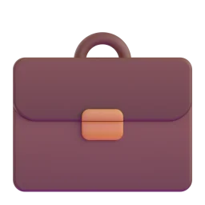
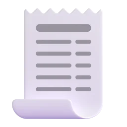
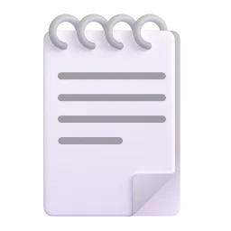
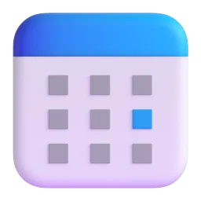
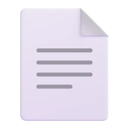

# Awesome Siri Skills

> A curated library of **Siri app skills**, plus a CLI and MCP server to validate and ship them.

[](https://github.com/HenryAgentTeam/awesome-siri-skills/actions/workflows/ci.yml)
[](https://www.npmjs.com/package/siriskills)
[](LICENSE)
[](https://siriskills.com)
[](#mcp-server)

Since iOS 27.3, any app can plug into Siri AI through App Intents. **App skills** are short `SKILL.md` files in your app's `Skills.skillsbundle` that teach Siri *how to combine* your intents for a task: which tools to call, in what order, when to ask, and what never to do.

This repo gives you:

- **[40 example skills](#skill-library)** across 18 app categories. Copy a folder into your bundle and rename the tools.
- **[`siriskills` CLI](#cli)** that validates every bundle in your Xcode project, including the traps Xcode stays silent about.
- **[MCP server](#mcp-server)** so Claude Code, Cursor, or VS Code can write, install, and validate skills for you.

> [!NOTE]
> These are *Siri app skills*, read by Siri's model on the user's device. They are not coding-assistant skills, even though both use `SKILL.md`.

## Contents

- [Quick start](#quick-start)
- [How app skills work](#how-app-skills-work)
- [Skill library](#skill-library)
- [CLI](#cli)
- [MCP server](#mcp-server)
- [Resources](#resources)
- [Contributing](#contributing)

## Quick start

```bash
# Check every Skills.skillsbundle in your project
npx -y siriskills validate .

# Start from an example
npx -y siriskills add reorder-delivery --bundle MyApp/Skills.skillsbundle

# Or let your coding agent do it
claude mcp add siriskills -- npx -y siriskills mcp
```

Prefer a browser? Use the [generator](https://siriskills.com/generator/) and [validator](https://siriskills.com/validate/) on siriskills.com.

## How app skills work

```
MyApp/
└── Skills.skillsbundle/          ← one per target (Skills Bundle template in Xcode)
    └── Skills/
        └── reorder-delivery/     ← folder name == skill name
            └── SKILL.md          ← the only file that ships
```

```markdown
---
name: reorder-delivery
description: Reorder food from a past delivery. Use when the user asks to reorder, order again, or get the usual. Not for browsing menus.
---

# Reorder a Delivery

1. Use the Find Past Orders tool. If more than one order matches, ask which one.
2. Add each item with the Add to Cart tool, keeping the same quantities.
3. Use the Show Cart tool and ask the user to confirm before they pay.
```

The rules, from Apple's Skills Bundle documentation:

| Rule | Why it matters |
|---|---|
| Frontmatter has only `name` and `description` | Any other field is ignored with a warning |
| `name` is kebab-case, ≤ 64 chars, **equals the folder name** | Otherwise it's a build error |
| `description` ≤ 1,024 chars | **Siri routes on the description alone**, so put the phrasing and boundaries there |
| Refer to tools by title ("the Add to Cart tool") | Swift type names aren't part of the API |
| Only `SKILL.md` is compiled | `references/` and other files are ignored |
| **One error anywhere means no skills ship at all** | Not just the broken one |
| Bundle must be in **Copy Bundle Resources** | Otherwise nothing compiles and Xcode shows no message |
| Skill names must be unique across app, extensions, frameworks | Duplicates silently drop one, undefined which |
| Skills guide; they don't enforce | Protect sensitive actions in code, not in prose |

## Skill library

Every skill is written for a **hypothetical app**. None is taken from a shipping app. Rename the tools to match your own App Intents titles. Browse them with icons and notes at [siriskills.com/templates](https://siriskills.com/templates/).

<!-- skills:start -->
<!-- Generated by `npm run readme`. Edit skills/*/README.md instead. -->

**40 skills across 18 categories.** Each one passes the Skills Bundle build rules in CI.

### Business

| | Skill | Name | What it handles |
|---|---|---|---|
|  | [**Send an invoice**](skills/invoice-send/SKILL.md) | `invoice-send` | Create an invoice for a client from a sentence and leave it as a draft for review. |

### Education

| | Skill | Name | What it handles |
|---|---|---|---|
|  | [**Log reading progress**](skills/reading-progress/SKILL.md) | `reading-progress` | Update the current book's page, and ask which book when two are in progress. |
|  | [**Practice today's lesson**](skills/lesson-practice/SKILL.md) | `lesson-practice` | Start the next due lesson, or review mistakes when the user asks to practice. |

### Entertainment

| | Skill | Name | What it handles |
|---|---|---|---|
|  | [**Get movie tickets**](skills/movie-tickets/SKILL.md) | `movie-tickets` | Find showtimes for a film nearby and hold seats only after the user picks a time. |
|  | [**Invite friends to play**](skills/game-session/SKILL.md) | `game-session` | Invite online friends to a party for a game the user names. |
|  | [**What should I watch**](skills/watch-next/SKILL.md) | `watch-next` | Pick one show to continue or start, based on what the user's in the middle of. |

### Finance

| | Skill | Name | What it handles |
|---|---|---|---|
|  | [**Check a budget**](skills/budget-check/SKILL.md) | `budget-check` | Answer "can I afford it" against what's left in a category this month. |
|  | [**File a receipt**](skills/receipt-capture/SKILL.md) | `receipt-capture` | Attach a receipt to the right expense report and ask before creating a new one. |
|  | [**Split an expense with friends**](skills/split-expense/SKILL.md) | `split-expense` | Handle "split dinner with Sam and Alex, 90 dollars" end to end, including the cases where a name matches two people. |

### Food & Drink

| | Skill | Name | What it handles |
|---|---|---|---|
|  | [**Order the usual coffee**](skills/coffee-usual/SKILL.md) | `coffee-usual` | Get a regular's order in for pickup at the nearest store, with the right size and milk. |
|  | [**Plan the week's dinners**](skills/meal-plan-week/SKILL.md) | `meal-plan-week` | Fill the week's dinner slots from saved recipes without overwriting meals already planned. |
|  | [**Reorder a past delivery**](skills/reorder-delivery/SKILL.md) | `reorder-delivery` | Let people say "order the usual" and get last week's order back in the cart, without Siri ever checking out on its own. |

### Health & Fitness

| | Skill | Name | What it handles |
|---|---|---|---|
|  | [**Explain a heart rate reading**](skills/heart-check/SKILL.md) | `heart-check` | Summarize the latest reading in plain words and point to the app's guidance, never a diagnosis. |
|  | [**Log a medication dose**](skills/log-dose/SKILL.md) | `log-dose` | Mark a dose as taken from a sentence, and ask before logging a dose that looks like a double. |
|  | [**Log a workout from a sentence**](skills/log-workout/SKILL.md) | `log-workout` | Turn "I just ran 5K in 28 minutes" into a logged session, and know when to ask instead of guessing the activity. |
|  | [**Save a bike ride**](skills/ride-log/SKILL.md) | `ride-log` | Save a ride with the route the user describes, and ask about the bike when they own more than one. |
|  | [**Start a wind-down routine**](skills/sleep-wind-down/SKILL.md) | `sleep-wind-down` | Start tonight's routine, set the alarm the user mentions, and stay quiet about stats unless asked. |

### Lifestyle

| | Skill | Name | What it handles |
|---|---|---|---|
|  | [**Log a feed or nap**](skills/baby-log/SKILL.md) | `baby-log` | Record feeds, naps and diapers from a short sentence at 3 a.m. |
|  | [**Log a pet's meal**](skills/pet-feeding/SKILL.md) | `pet-feeding` | Record a feeding for the right pet and warn if it looks like a second dinner. |

### Music

| | Skill | Name | What it handles |
|---|---|---|---|
|  | [**Build a playlist**](skills/playlist-build/SKILL.md) | `playlist-build` | Make a playlist from a mood or activity and the user's own library. |
|  | [**Catch up on podcasts**](skills/podcast-catchup/SKILL.md) | `podcast-catchup` | Queue unplayed episodes from favorite shows, shortest first when time is short. |

### Navigation

| | Skill | Name | What it handles |
|---|---|---|---|
|  | [**Find where to return a rental car**](skills/car-rental-return/SKILL.md) | `car-rental-return` | Get directions to the return location and remind about fuel, without changing the booking. |
|  | [**Remember where I parked**](skills/parking-find/SKILL.md) | `parking-find` | Save or recall a parking spot with the floor and the time left on the meter. |

### News

| | Skill | Name | What it handles |
|---|---|---|---|
|  | [**Get a morning briefing**](skills/news-brief/SKILL.md) | `news-brief` | Read the top stories from the user's followed topics in under two minutes. |

### Photo & Video

| | Skill | Name | What it handles |
|---|---|---|---|
|  | [**Make an album from a trip**](skills/photo-album/SKILL.md) | `photo-album` | Gather a trip's photos into an album, skipping screenshots and duplicates. |

### Productivity

| | Skill | Name | What it handles |
|---|---|---|---|
|  | [**Clean up a folder of notes**](skills/organize-notes/SKILL.md) | `organize-notes` | Define what "clean up" means in your app, so Siri groups and archives notes the way your users expect. |
|  | [**Find time for a meeting**](skills/calendar-find-time/SKILL.md) | `calendar-find-time` | Find a free slot that works for the people named, then propose instead of booking. |
|  | [**Follow up on an email**](skills/email-followup/SKILL.md) | `email-followup` | Draft a short follow-up to the last unanswered thread with someone, and leave sending to the user. |
|  | [**Save a voice memo to a project**](skills/voice-memo/SKILL.md) | `voice-memo` | File the last recording under the right project with a title from what was said. |
|  | [**Summarize a document**](skills/doc-summary/SKILL.md) | `doc-summary` | Summarize the document on screen or by name, in the length the user wants. |
|  | [**Triage today's to-dos**](skills/todo-triage/SKILL.md) | `todo-triage` | Sort what's due today into now, later and someday, and only move tasks after a yes. |

### Shopping

| | Skill | Name | What it handles |
|---|---|---|---|
|  | [**Add a recipe's groceries**](skills/grocery-add/SKILL.md) | `grocery-add` | Add only the missing ingredients of a recipe to the list, merged with what's already there. |
|  | [**Start a return**](skills/return-item/SKILL.md) | `return-item` | Start a return for an item, check the return window, and ask about refund or exchange. |
|  | [**Track a package**](skills/order-track/SKILL.md) | `order-track` | Answer "where's my order" with the latest status and delivery window. |

### Smart Home

| | Skill | Name | What it handles |
|---|---|---|---|
|  | [**Set the house to away**](skills/home-away/SKILL.md) | `home-away` | Lock up, lower the heating and turn off lights, but ask before arming the alarm. |

### Social

| | Skill | Name | What it handles |
|---|---|---|---|
|  | [**Plan something with friends**](skills/group-plan/SKILL.md) | `group-plan` | Start a poll in the right group for a plan with options the user gives. |

### Travel

| | Skill | Name | What it handles |
|---|---|---|---|
|  | [**Ask for late checkout**](skills/hotel-late-checkout/SKILL.md) | `hotel-late-checkout` | Request late checkout for the current stay, with the time the user wants. |
|  | [**Check in for a flight**](skills/flight-check-in/SKILL.md) | `flight-check-in` | Get from "check me in for tomorrow's flight" to a boarding pass, with the right questions when there are several travellers or legs. |

### Utilities

| | Skill | Name | What it handles |
|---|---|---|---|
|  | [**Report a broken thing at home**](skills/repair-request/SKILL.md) | `repair-request` | Turn "the kitchen tap is leaking" into a repair request with the right category. |

### Weather

| | Skill | Name | What it handles |
|---|---|---|---|
|  | [**Should I bring an umbrella**](skills/weather-plan/SKILL.md) | `weather-plan` | Answer the practical question, not the forecast table, for where the user is going. |

<!-- skills:end -->

## CLI

```
siriskills validate [path…]        Validate bundles under path (default .), a skill folder, or a SKILL.md
    --strict                       Treat warnings as errors (good for CI)
    --tips                         Also show description routing tips
    --json                         Machine-readable output
siriskills check-build <App.app>   Confirm Xcode compiled your skills (.skillsc) into a built app
siriskills new <name>              Scaffold Skills/<name>/SKILL.md   [--bundle path] [--force]
siriskills list [category]         List the example skills
siriskills show <name>             Print an example skill
siriskills add <name>              Copy an example skill into your bundle   [--bundle path] [--as name]
siriskills mcp                     Run the MCP server over stdio
```

What `validate` catches that the Xcode build doesn't:

```
$ npx siriskills validate .
App/Skills.skillsbundle/Skills/plan-meal/SKILL.md:3: error: 'plan-meal': YAML syntax error. An unquoted ": " inside the description is the usual cause.
✗ App/Skills.skillsbundle — 4 skills
✓ Widget/Skills.skillsbundle — 1 skill
warning: skill name 'reorder-delivery' is used twice; only one is kept and which one is undefined:
  App/Skills.skillsbundle/Skills/reorder-delivery/SKILL.md
  Widget/Skills.skillsbundle/Skills/reorder-delivery/SKILL.md

1 error: the app will ship with no skills at all.
```

Add it to CI:

```yaml
- run: npx -y siriskills validate . --strict
```

After building, confirm the bundle actually compiled:

```bash
npx siriskills check-build ~/Library/Developer/Xcode/DerivedData/MyApp-*/Build/Products/Debug-iphoneos/MyApp.app
```

## MCP server

Two ways to connect. Both are free, with no API key.

| | Local (stdio) | Hosted |
|---|---|---|
| Run | `npx -y siriskills mcp` | `https://siriskills.com/mcp` |
| Reads your project's bundles | ✅ | — |
| Writes skills into your bundle | ✅ | — |
| Validate, templates | ✅ | ✅ |
| Guides | — | ✅ |

**Claude Code**

```bash
claude mcp add siriskills -- npx -y siriskills mcp                 # local
claude mcp add --transport http siriskills-web https://siriskills.com/mcp   # hosted
```

**Cursor / VS Code / Claude Desktop** (`mcp.json`)

```json
{
  "mcpServers": {
    "siriskills": { "command": "npx", "args": ["-y", "siriskills", "mcp"] }
  }
}
```

Local tools: `validate_skill`, `validate_bundle`, `check_build`, `list_templates`, `get_template`, `write_skill`.

Try: *"Add a Siri skill to my app for reordering past orders, using my intents' real titles, then validate the bundle."*

## Resources

### Official

- [Siri AI is now open to all developers](https://developer.apple.com/news/?id=gdk2umrf) — Apple's announcement (Nov 3, 2026).
- [App Intents documentation](https://developer.apple.com/documentation/appintents) — tools, entities, and parameters that skills orchestrate.
- [Apple's Siri integration guidance for coding agents](https://github.com/artemnovichkov/xcode-skills/tree/main/skills/siri-app-integration) — mirror of the Xcode assistant skill, including the Skills Bundle reference.

### Tools

- [siriskills.com](https://siriskills.com) — generator, validator, and templates in the browser.
- [siriskills CLI and MCP](#cli) — this repo.

### Guides

- [Write a description Siri actually picks](https://siriskills.com/guides/write-a-description-siri-picks/)
- [Why Siri ignores all of your skills](https://siriskills.com/guides/why-siri-ignores-your-skills/)
- [When a skill is worth writing](https://siriskills.com/guides/when-to-write-a-skill/)

### Articles and discussion

- [Siri AI opens to every app in the iOS 27.3 beta. Its app skills are SKILL.md files](https://dev.to/gabrielanhaia/siri-ai-opens-to-every-app-in-the-ios-273-beta-its-app-skills-are-skillmd-files-4dc5) — DEV Community.
- [Developers can now create advanced app skills for Siri AI](https://9to5mac.com/2026/11/03/developers-can-now-create-advanced-app-skills-for-siri-ai/) — 9to5Mac.
- [Techmeme roundup](https://www.techmeme.com/261103/p27)

### Related

- [Siri AI Apps](https://siriaiapps.com) — directory of apps that support Siri AI.

## Contributing

New skills, fixes, and resources are welcome. See [CONTRIBUTING.md](CONTRIBUTING.md). Every skill must pass `npm run validate`, and must be written for a hypothetical app.

## License

[MIT](LICENSE). Icons from [Fluent Emoji](https://github.com/microsoft/fluentui-emoji) by Microsoft (MIT).

Not affiliated with, endorsed by, or sponsored by Apple Inc. Apple, Siri, Xcode, and App Intents are trademarks of Apple Inc., registered in the U.S. and other countries.
